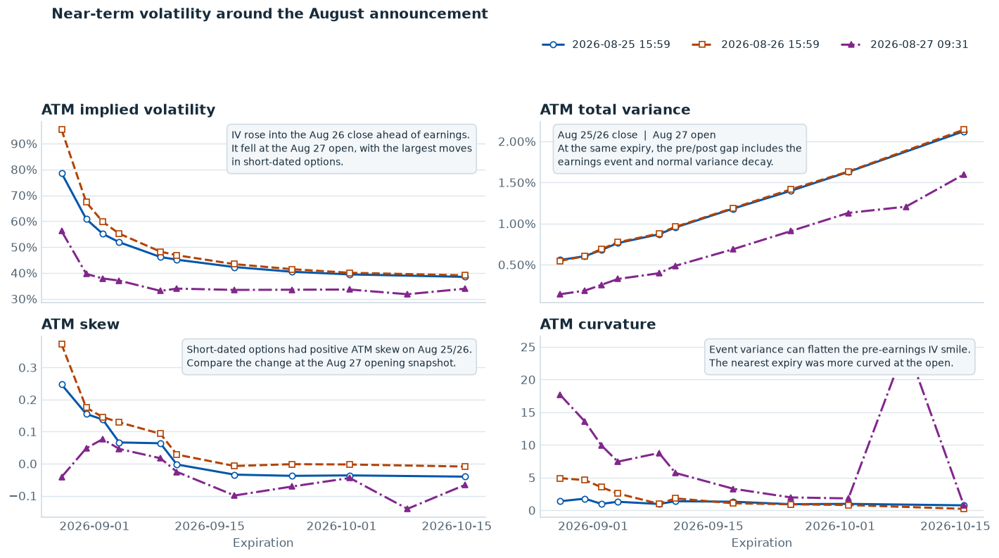
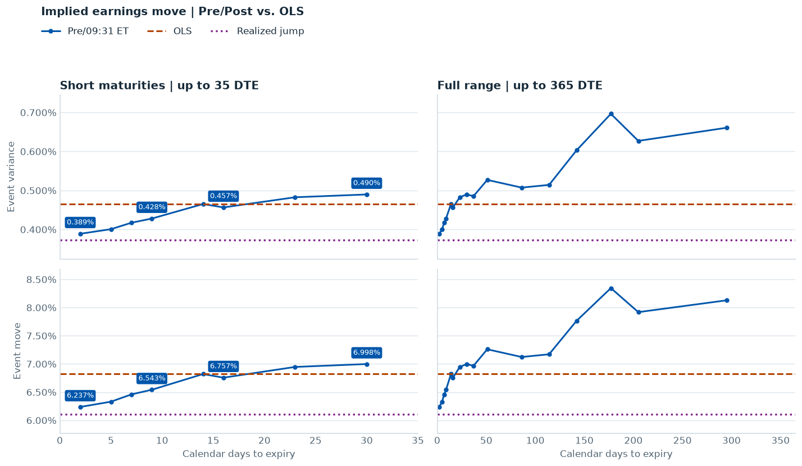
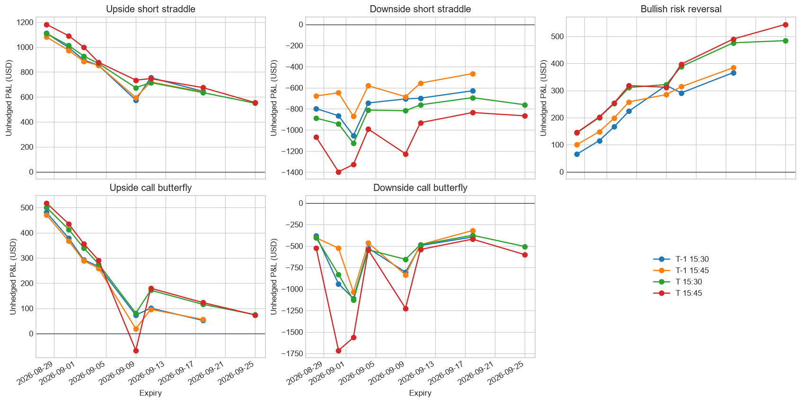
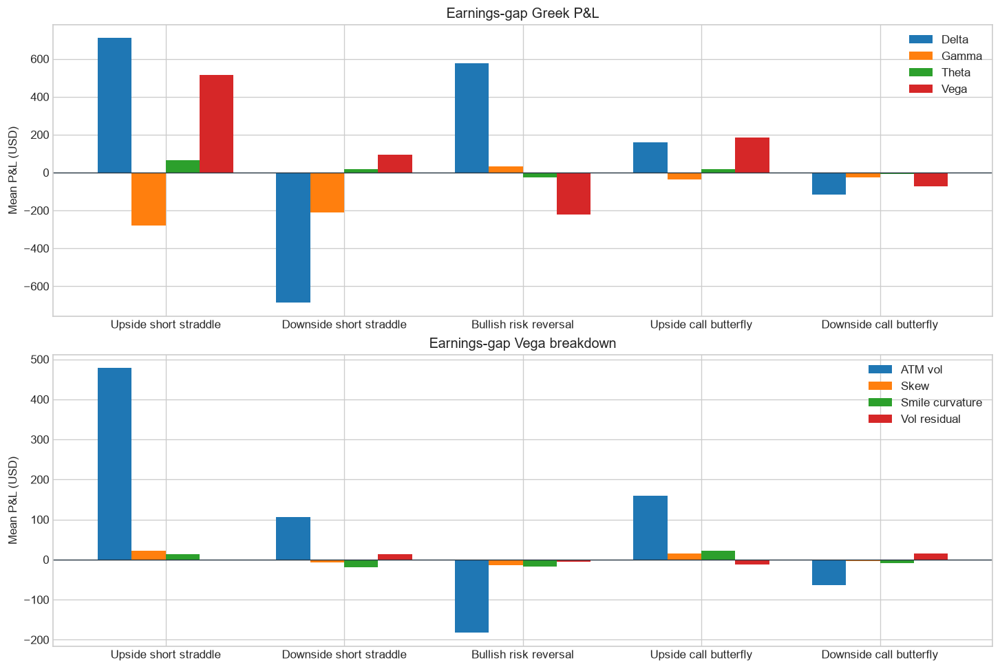

# Earnings Event Volatility

This project studies options strategies that can be executed around earnings announcements in U.S. single stocks. The first case study uses NVDA's August 26, 2026 earnings release to estimate how much event risk was priced into options and compare it with the stock's subsequent overnight move. [NVIDIA earnings release](https://investor.nvidia.com/news/press-release-details/2026/NVIDIA-Announces-Financial-Results-for-Second-Quarter-Fiscal-2027/)

## Method

1. **Prepare quotes.** Join each option quote to the latest available contract definition and underlying quote. Keep valid two-sided quotes and compute midprices. Use near-the-money call/put pairs and put-call parity to estimate the forward for each timestamp and expiry.
2. **Estimate ATM IV and total variance.** Invert Black–76 at the bid, mid, and ask. Fit a spread-weighted quadratic to out-of-the-money mid IVs near zero log-forward moneyness. The intercept is ATM IV, the linear coefficient measures skew, and the quadratic coefficient measures curvature. ATM total variance is `ATM IV² × variance time`.
3. **Estimate event variance two ways.** The pre-earnings OLS fit models total variance as `event variance + base variance rate × variance time` for maturities up to 31 calendar days. Its intercept estimates event variance. The pre/post method matches expiries and subtracts normal variance decay from the change in total variance between the two snapshots. The implied earnings move is the square root of a nonnegative event variance estimate.

The OLS interpretation assumes that the fitted expiries span the announcement, one earnings event contributes the same additive variance to those expiries, and the base variance rate is approximately constant across the fit window. The pre/post estimate also assumes the base variance rate stays stable between snapshots and that no other material shock drives the change. The post snapshot uses the first minute after the next regular-session open to limit the effect of post-announcement intraday repricing. The variance clock weights non-trading hours at 0.4 relative to trading hours. The forward fit uses a fixed 4% discount rate, and European Black–76 approximates American equity options.

## Results

### Near-term volatility around the August announcement

The charts use the last valid close-window snapshots on August 25 and 26, both stamped 15:59 ET, and the first opening-minute snapshot on August 27, stamped 09:31 ET. The opening snapshot aligns the post-earnings smile with the backtest's exit window.



- ATM IV was higher near the August 26 close than on August 25 and fell at the August 27 open. The shortest expiries showed the largest changes.
- For the August 28 expiry, ATM smile curvature rose from about **4.91** before earnings to **17.65** at the next open. Curvature is the second derivative of IV with respect to log-forward moneyness.
- At a matched expiry, the drop in total variance reflects both the removal of earnings risk and the passage of variance time. The pre/post estimator subtracts the estimated normal decay.

### Implied earnings move | Pre/Post vs. OLS



- The August 26 close OLS fit implied a move of about **6.83%**. Using the August 27 opening snapshot, the shortest matched expiry's pre/post estimate was about **6.24%**.
- NVDA's August 26 close to August 27 open log return was **+6.11%**. The implied estimates exceeded this one realized move. Establishing a repeatable premium or strategy P&L requires more events and executable prices.

## Reproduce

Run the commands from the repository root. [event-vol.ipynb](notebooks/event-vol.ipynb) reads local files from `data/raw/`. The reusable research and backtest modules are under `helpers/`. The executable backtest example is [event-backtest.ipynb](notebooks/event-backtest.ipynb).

### 1. Create the environment

```powershell
py -3.13 -m venv .venv-event-vol
$python = (Resolve-Path ".\.venv-event-vol\Scripts\python.exe").Path
& $python -m pip install ipykernel numpy pandas scipy matplotlib pandas-market-calendars databento tqdm python-dotenv Jinja2 yfinance
& $python -m ipykernel install --user --name event-vol --display-name "Python 3.13 (Event Vol)"
```

### 2. Prepare the Databento inputs

The notebook uses the close windows on **2026-08-25 and 2026-08-26** and the opening window on **2026-08-27**. Contract definitions are required for all three dates.

| Dataset and schema | Symbol | Required file in `data/raw/` | Window per date |
| --- | --- | --- | --- |
| `OPRA.PILLAR` / `cbbo-1m` | `NVDA.OPT` | `NVDA_opra.pillar_cbbo-1m_<date>.dbn.zst` | Aug 25–26 close window, 15:30–16:00 ET |
| `OPRA.PILLAR` / `definition` | `NVDA.OPT` | `NVDA_opra.pillar_definition_<date>.dbn.zst` | 00:00 UTC through 00:00 UTC the next day |
| `EQUS.MINI` / `bbo-1m` | `NVDA` | `NVDA_equs.mini_bbo-1m_<date>.dbn.zst` | Aug 25–26 close window, 15:30–16:00 ET |
| `OPRA.PILLAR` / `cbbo-1m` | `NVDA.OPT` | `NVDA_opra.pillar_cbbo-1m_2026-08-27_open_30m.dbn.zst` | Aug 27 open window, 09:31–10:00 ET snapshot timestamps |
| `EQUS.MINI` / `bbo-1m` | `NVDA` | `NVDA_equs.mini_bbo-1m_2026-08-27_open_30m.dbn.zst` | Aug 27 open window, 09:31–10:00 ET snapshot timestamps |

If you need the files, copy `.env.example` to `.env` and set `DATABENTO_API_KEY` locally. The downloader estimates costs and asks for confirmation before downloading missing files. Append `--dry-run` to estimate costs only.

```powershell
foreach ($day in "2026-08-25", "2026-08-26") {
    & $python -m helpers.download_data $day
}
& $python -m helpers.download_data 2026-08-27 --window open
```

### 3. Prepare the Yahoo Finance daily bars

Save NVDA's regular-session daily OHLCV to `data/raw/NVDA_daily_ohlcv.csv`, with columns `session_date,open,high,low,close,volume`. The local cache covers all 973 trading sessions from the requested January 1, 2023 to November 17, 2026 window. The August comparison needs the August 26 regular-session close and August 27 regular-session open. Its signed realized jump is `log(next open / prior close)`. [yfinance history reference](https://ranaroussi.github.io/yfinance/reference/yfinance.price_history.html)

From a Python session in the project environment, run the following. The end date is exclusive. If the final bar is incomplete in the range response, request that session separately before saving.

```python
from pathlib import Path

import pandas as pd
import yfinance as yf

ticker = yf.Ticker("NVDA")
columns = ["Open", "High", "Low", "Close", "Volume"]
settings = dict(interval="1d", auto_adjust=False, actions=False, prepost=False)
bars = ticker.history(start="2023-01-01", end="2026-11-18", **settings)[columns].dropna()
if "2026-11-17" not in bars.index.strftime("%Y-%m-%d"):
    last = ticker.history(start="2026-11-17", end="2026-11-18", **settings)
    bars = pd.concat([bars, last[columns].dropna()]).sort_index()
bars.index = bars.index.strftime("%Y-%m-%d")
bars.index.name = "session_date"
bars.columns = bars.columns.str.lower()
if not bars.index.is_unique or "2026-11-17" not in bars.index:
    raise ValueError("Missing final trading session or duplicate dates")
path = Path("data/raw/NVDA_daily_ohlcv.csv")
path.parent.mkdir(parents=True, exist_ok=True)
bars.to_csv(path)
```

### 4. Run the analysis

Open [event-vol.ipynb](notebooks/event-vol.ipynb), select **Python 3.13 (Event Vol)**, and run the cells from top to bottom. The notebook builds the quote-derived estimates first, then plots the term structures, decomposes event variance, and compares the pre/post and OLS estimates with the realized jump. Run `& $python -m tests.test_helper` to check the synthetic pipeline, IV inversion, plots, and event-aware regression.

### 5. Backtest strategies

The backtest engine supports straddles, risk reversals, and butterflies. Open
[event-backtest.ipynb](notebooks/event-backtest.ipynb) for a worked example of
NVDA's August 26, 2026 earnings release, labeled 2026Q2 in this project.
The notebook shows how to join quotes, select strikes, compare unhedged and
delta-hedged P&L, and reconcile the Greek and Vega attribution.

Use `helpers.event_backtest` for earnings released after the regular close.
The example replays upside- and downside-target short straddles, a bullish
risk reversal, and equal-width call butterflies at both implied-move targets.
It uses the same T−1 and T close windows and T+1 open window downloaded in step 2.

Run the example from the command line with the following command. Pass
`--event` more than once to replay multiple dates.

```powershell
& .\.venv-event-vol\Scripts\python.exe -m helpers.event_backtest --ticker NVDA --event 2026-08-26 --strategy straddle --strategy risk-reversal --strategy butterfly --center up --center down --delta-hedge --output-dir experiments/nvda-backtest
```

- `trades.csv` records priced and unpriced setups, fill P&L, stock hedge P&L,
  fees, and total and earnings-gap attribution. `legs.csv` records the contracts,
  signed quantities, fills, and individual attribution. `summary.csv` groups priced
  trades by event, strategy, expiry, and entry time.
- The default entries are 30 and 15 minutes before T−1 and T close. The exit is
  the first common executable minute in the first half-hour of T+1. Buys cross
  the ask and sells cross the bid, sized to the leg ratio. Butterfly wings are
  symmetric around the selected strike. The default target wing width is
  `center * sinh(implied_move)`; `--wing-width` requires an exact width in USD.
- Vega is repriced sequentially through ATM IV, skew, smile curvature, and
  the bid-mark IV residual at fixed new spot and variance time. Skew and
  curvature include the change in the contract's forward moneyness. When a
  surface is missing or a counterfactual IV is negative, only the affected
  period's finer breakdown is omitted; Vega and execution P&L remain available.
- The CLI assumes a standard 100-share contract, Black–76 with a 4% rate and
  0.4 off-hours variance weight, executable displayed quotes, and zero
  financing and borrow costs. `--fees` sets the additional round-trip USD cost
  per structure.

Run `& $python -m tests.test_backtest` with the same Python environment to check multi-leg
fills, butterfly sizing, stock hedge P&L, and attribution reconciliation.





## Research Log

### 2026-11-25

1. **What I did.** Added a 30-minute opening quote window to the downloader and local loader, built a reusable earnings study, and excluded local experiment files from Git. Standardized the close analysis on the last valid ATM snapshot across the notebook's term structure, smiles, OLS, and pre/post comparisons. Added a backtest engine and a worked NVDA notebook with bid/ask execution, optional stock delta hedging, and trade- and leg-level Greek attribution. Split Vega into ATM vol, skew, smile curvature, and a residual, including a separate earnings-gap view. Grouped reusable Python modules, notebooks, and regression tests under `helpers/`, `notebooks/`, and `tests/`.
2. **What I saw.** The new engine reproduced 906 legacy straddle and risk reversal replays across 14 NVDA earnings events. The 2026Q2 notebook priced and reconciled all 150 option structures, including 60 butterflies. Six downside butterflies had no usable entry bid-side IV for the lowest-strike call, so their unhedged P&L was available and their hedge result was missing. The replays within each earnings event share the same underlying move, so the NVDA example demonstrates execution and attribution without establishing a repeatable strategy edge.
3. **What I will change next.** Evaluate results at the earnings-event level, separate spread costs from model-mark differences, and normalize position size across events. Define an ex-ante universe and validation rules before expanding to more stocks and testing whether implied moves are rich relative to historical earnings jumps.

### 2026-11-18

1. **What I did** — Built the NVDA August earnings case study from minute option and underlying quotes. Compared the pre-earnings OLS estimate, matched-expiry pre/post estimates, and the realized overnight stock move.
2. **What I saw** — The IV drop and curvature jump were strongest at short maturities. The implied move was above the realized overnight jump for this event.
3. **What I will change next** — Analyze more earnings dates and expand to U.S. single-stock options across multiple sectors. Use consistent snapshot windows and estimation settings so the results can be compared across events and sectors.
